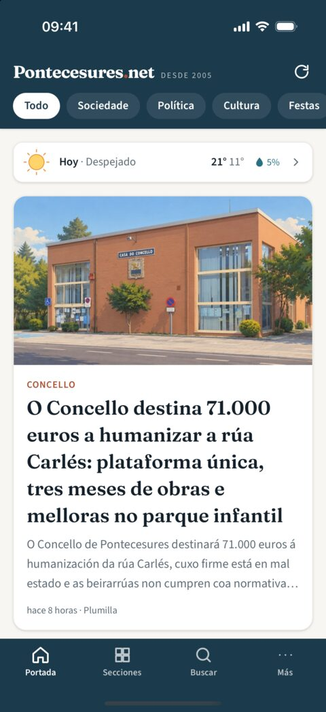
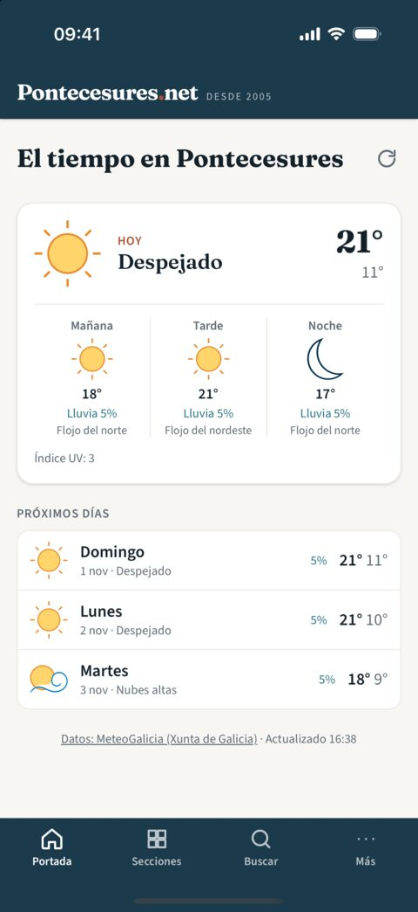
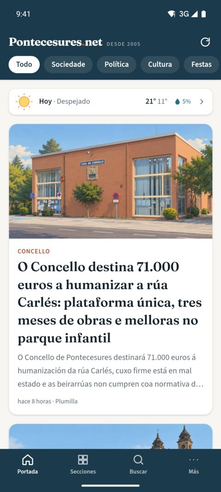
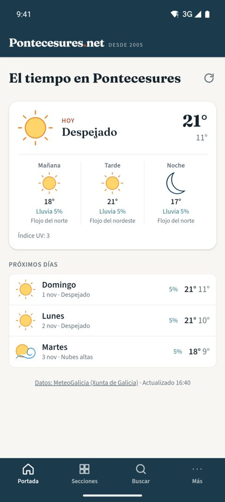

# Pontecesures.net Mobile

Mobile app (iOS & Android) for [pontecesures.net](https://pontecesures.net), the
local news site of Pontecesures (Galicia) since 2005. Built with
[Wails v3](https://wails.io) — a Go backend plus a web frontend rendered in the
native WebView — so the same codebase also runs on desktop.

The app UI is available in **Spanish and Galician** (chosen in Settings,
defaulting to the device language); news content comes from the site as-is.

## Screenshots

|         | Front page | Article | Weather |
| ------- | :--------: | :-----: | :-----: |
| **iOS** |  |  |  |
| **Android** |  |  |  |

<sub>iOS Simulator (iPhone 16 Pro) and Android Emulator (Pixel 7, Android 15),
light theme, Spanish UI. The app also runs on a physical iPhone with iOS 27.</sub>

## Features

- Front page with infinite scroll and section filter chips
- Section list with the website's section illustrations
- Full-text search across ~30,000 articles
- Article view with sanitised content; links to other articles open in-app,
  external links open in the system browser
- Related posts under each article ("Más sobre esto")
- Weather for Pontecesures from MeteoGalicia: a discreet line on the front
  page and a forecast view (today by time slot, next days, warnings)
- Settings: language (Spanish/Galician), light/dark/automatic theme and text
  size; an account block will be added once accounts exist
- Full-screen image viewer with pinch and double-tap zoom (posters and
  obituaries are images with text)
- Save articles to read later, also offline
- Search by relevance or date, optionally within a section
- Pull to refresh; content refreshes itself after 15+ minutes away
- Android back button and iOS edge swipe navigate inside the app
- Native share sheet on mobile (copies the link on desktop)
- Offline reading of anything already loaded (file cache)
- Light & dark themes using the website's design tokens

User accounts (optional login and registration) are planned for a later phase
— see [docs/ROADMAP.md](docs/ROADMAP.md).

## Stack

| Layer | Tech |
| --- | --- |
| Shell | Wails v3.1.0 (mobile support is **experimental** upstream) |
| Backend | Go 1.26+, WordPress REST API client in `internal/wp` |
| Frontend | Vite + TypeScript, Alpine.js, Tailwind CSS v4 |
| Server side | Optional WordPress plugin in `wordpress-plugin/pcn-mobile` |

## Getting started

Prerequisites: Go 1.26+, Node 24 (see `.nvmrc`), the `wails3` CLI and the
mobile toolchains you need.

```bash
go install github.com/wailsapp/wails/v3/cmd/wails3@v3.1.0
wails3 doctor
```

| Command | What it does |
| --- | --- |
| `wails3 dev` | Desktop window (phone-sized) with hot reload |
| `wails3 task ios:run` | Build and run on the iOS Simulator (macOS + Xcode with an iOS runtime) |
| `wails3 task android:run` | Build and run on the Android Emulator (SDK 35, NDK 26.3, JDK 21) |
| `wails3 task build:server && WAILS_SERVER_PORT=8765 bin/pontecesures-net-mobile-server` | Serve the full app over HTTP for quick checks in a browser |
| `go test ./internal/...` | Backend unit tests |

See [docs/DEVELOPMENT.md](docs/DEVELOPMENT.md) for toolchain setup and
architecture notes.

## Project layout

```
main.go               App bootstrap (window, iOS/Android options)
contentservice.go     Service bound to the frontend (posts, sections, share…)
weatherservice.go     Service bound to the frontend (MeteoGalicia forecast)
internal/wp/          WordPress client, HTML sanitising, image cascade, related
internal/meteo/       MeteoGalicia forecast client
internal/cache/       File cache for offline reading
frontend/             Vite + Alpine.js + Tailwind UI
  src/i18n/           UI strings: es.ts (Spanish), gl.ts (Galician)
  bindings/           Generated Go → TS bindings (do not edit)
build/                Wails platform projects (iOS, Android, desktop)
wordpress-plugin/     Optional pcn/v1 REST endpoints for the site
docs/                 Roadmap and development notes
```

## License

Code © Antonio Cortés (DrZippie), released under the [MIT License](LICENSE). News content and images shown
in the app belong to pontecesures.net and their authors and are not covered by
this license.
